# carrel

Read research papers on a tablet or a Mac with Claude Code beside them: the paper on one side, the chat on the other, and your whole paper library around them.

<p align="center">
  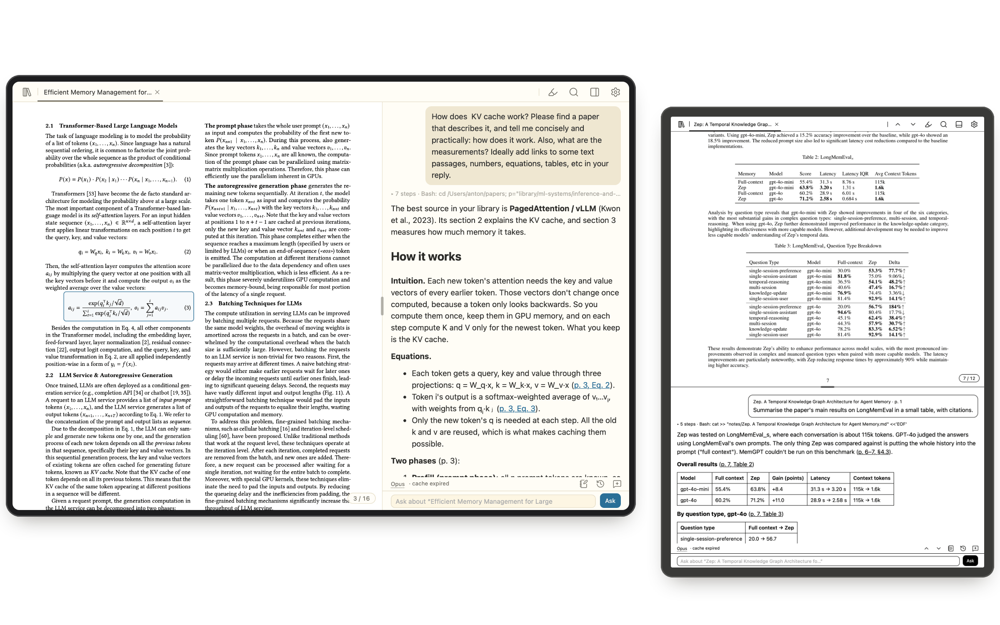
</p>

## Why I made it

I read a lot of papers, and I read them with an agent: I ask what a table shows, how a method differs from another paper's, whether a result holds up. At the desk, that is VS Code with the PDF on one side and Claude Code on the other, over [an agentic paper library](https://github.com/anton-dergunov/agentic-paper-library). Its answers cite the page and the table, and a click opens the PDF there.

Away from the desk I wanted the same thing on an iPad: the paper, the chat beside it, and the citations that turn the page. Carrel is that. The Claude Code session runs on your laptop, in the library, with its notes, skills and tools; the tablet only shows it. It grew into a reader for the whole library, and I now read with it every day.

## What you can do

**Read with Claude beside you**
- Tap a paper and it opens in a tab with a chat beside it, ready for a question about the paper and the page you are on.
- Answers cite the page, the table or the equation. Tap a citation and the paper turns there and marks the spot, or the cited paper opens in a tab of its own, beside the same chat.
- Select a passage, or tap a highlight, and ask about it: the passage goes with your question.
- Find words in the paper, jump through its contents, zoom with a pinch.

**Highlights that stay in the paper**
- Turn on the pen, select, and it is highlighted, in one of six colours. Highlights are saved into the PDF itself at once, so every PDF app sees them, and the paper's contents list them among its headings.

<p align="center">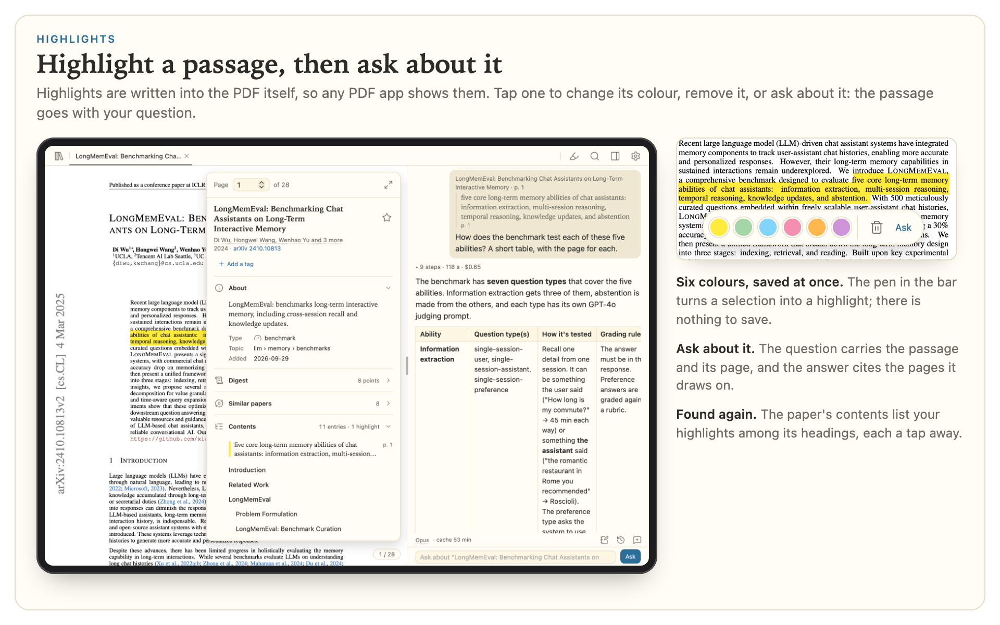</p>

**Everything the library knows of a paper**
- Tap the page number for the paper's sheet: its summary, type and topic, the agent's notes on it, similar papers, its contents, and your star and tags.
- Read the overview first: a three-minute note on the setting, the idea and why it works, written by the library's `/overview` and kept with your notes. Once written, it opens with no model call.

<p align="center">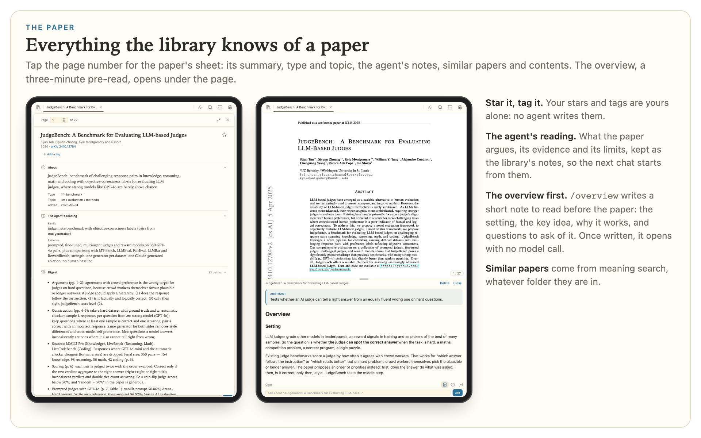</p>

**Your library at a glance**
- **Desk** picks up where you left off: the papers you were reading and asking about, the ones you starred to read, your tags, and what came in lately.
- **Areas** shows the whole library as a map of its topics, each with its subtopics, its literature review and its years.
- **All** lists every paper, filtered by area, type, years, your tags, or what you have worked with. **Timeline** lays them out year by year.
- **Map** lays the papers out by what they are about, so related papers sit together whatever folder they are in, with the regions named.
- Add a paper from arXiv, a web page or a PDF, or remove one, from the tablet.

<p align="center">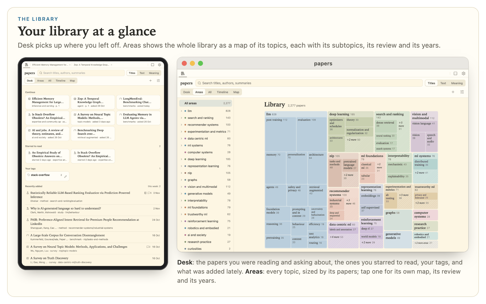</p>

<p align="center">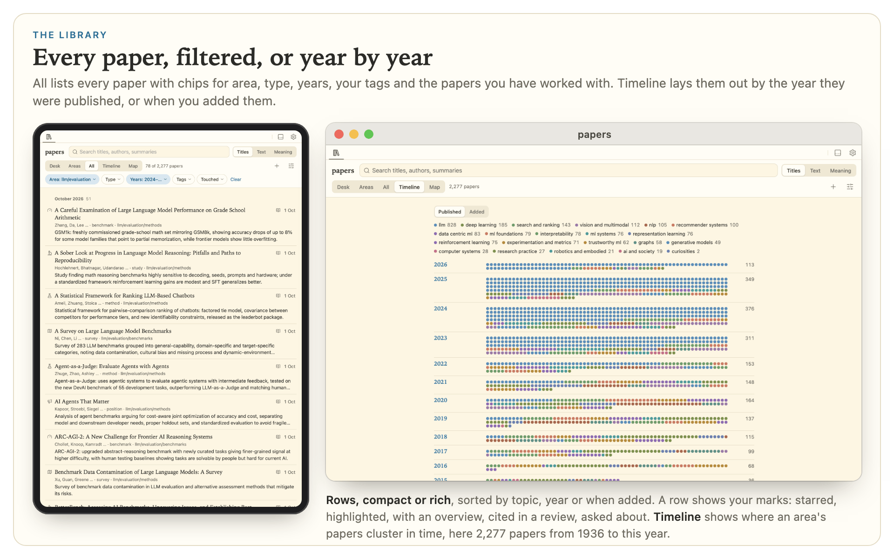</p>

**Search by the words, or by what you mean**
- Titles filter as you type. Text searches the full text of every paper and opens one at the page that matches.
- Meaning finds the papers nearest a description, in your own words, and the map lights them up. It uses the encoder the library's own experiment chose.

<p align="center">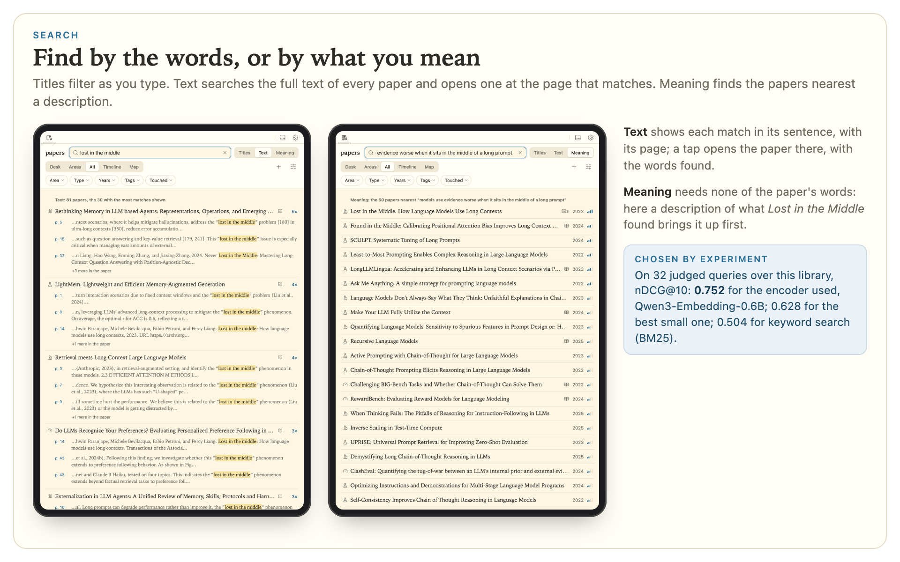</p>

<p align="center">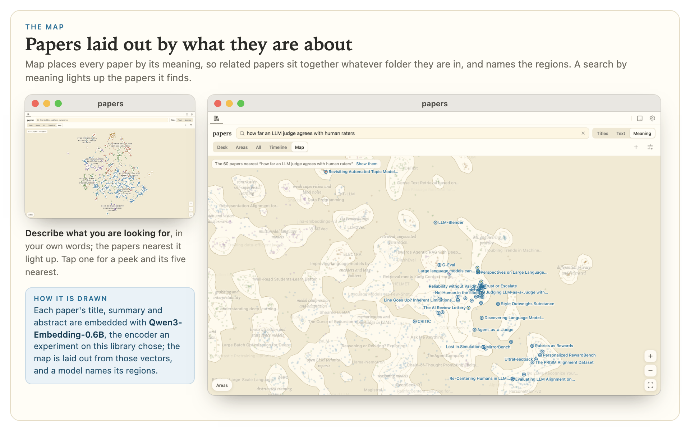</p>

**Reviews**
- An area's literature review opens in a tab of its own. Tap a paper it cites for a peek, then open it, or open it at the cited page.
- The chat beside a review is asked about the review.

<p align="center">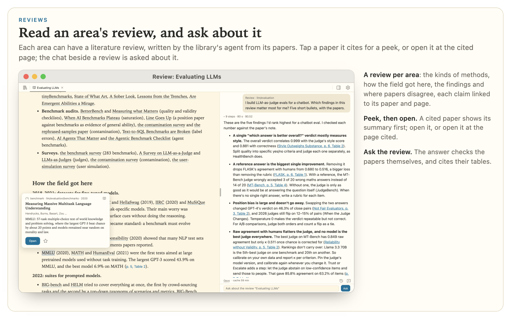</p>

**A chat that carries on**
- The chat lives on the laptop, so it carries on through a reload or a sleeping tablet. Start a new one, or go back to an earlier one, including the chats you had in VS Code or the terminal in the library; carrel's chats show up there too.
- Type `/` for the library's skills and Claude Code's commands.
- Maths, code, tables and diagrams are drawn properly.
- A line under the chat shows how long its prompt cache has left, and your usage limits.
- Anything beyond reading is put to you as Allow or Deny.

<p align="center">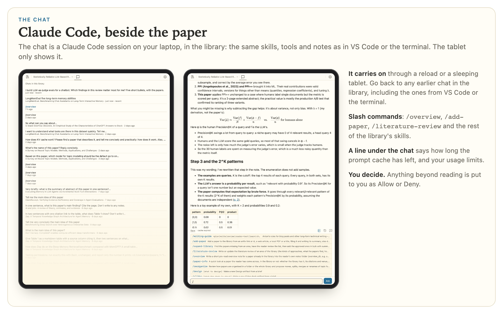</p>

**Make it yours** (remembered on each device)
- Carrel's light and dark colours, black and white, or e-ink.
- On an e-ink tablet nothing moves: pages turn instead of scrolling, with buttons for the paper and the chat.
- Adjust pages for a small or e-ink screen: bolder letters, sharper edges, darker greys, scanned pages in black and white.
- Put the chat below, above or beside the paper, over it, or on a tab of its own, and drag the split.
- Text sizes for the interface, the library and the chat, and the model each device starts its chats on.

<p align="center">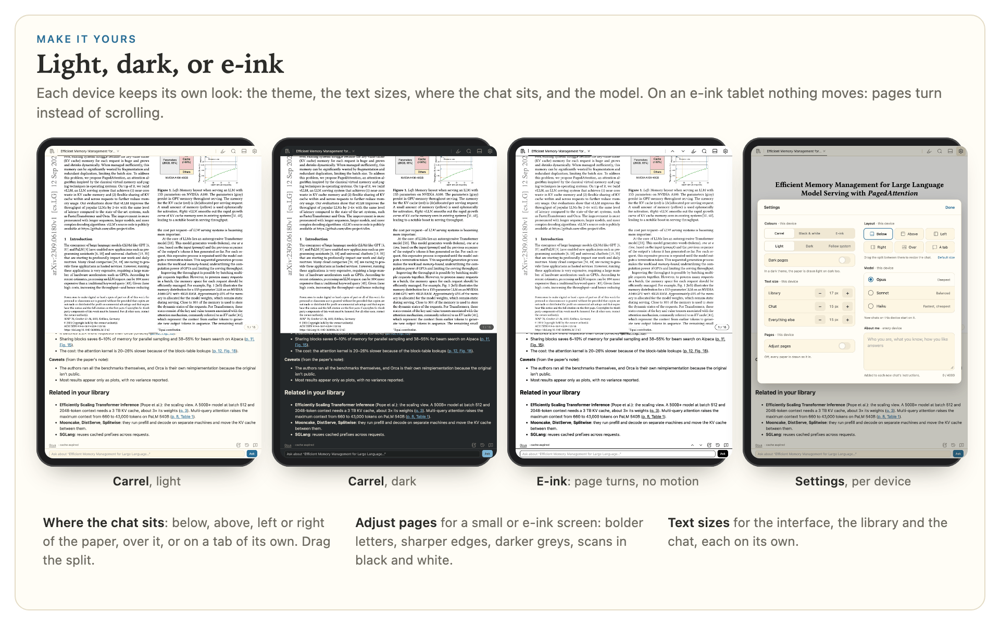</p>

**On the Mac too**
- The Mac app shows the same pages in a window of its own, with menus and the keys a Mac app has. It draws them with Chromium, so a paper flicked through as fast as the wheel spins stays painted.
- It uses the carrel already running, or starts one itself. It can live in the menu bar and open at login.

<p align="center">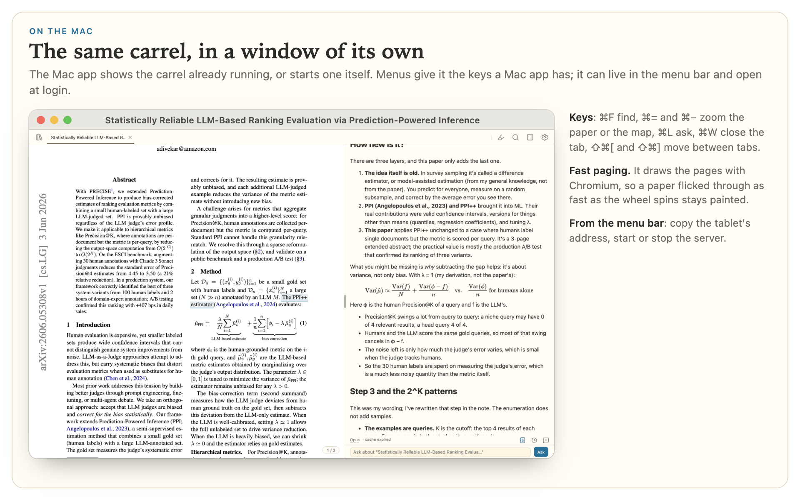</p>

## How it fits with the other two

Carrel is one of three projects that work together, and each also works alone:

| | What it is | Use it alone for |
|---|---|---|
| [agentic-paper-library](https://github.com/anton-dergunov/agentic-paper-library) | The library and its Claude Code skills: adding and filing papers, overviews, notes, literature reviews, meaning search | Reading and organising papers with Claude Code anywhere it runs |
| [PDF Viewer for VS Code](https://github.com/anton-dergunov/vscode-pdf-viewer) | A PDF viewer whose links open a paper at a page, table or section, from the Claude Code chat | Reading at the desk, in VS Code |
| carrel | The library, a paper and the chat, on a tablet or in a Mac app | Reading away from the desk |

The library's formats, prompts and models were each chosen by an experiment on real papers; the experiments are in its repository.

## How it compares

The "AI PDF readers" I tried (PaperNook, Open Paper, pdfpal, NotebookLM) keep the chat inside their app and the papers in their storage. Carrel is the other way round. Your papers stay in a folder on your laptop, and the agent is Claude Code, on your own plan: the same agent, skills and notes you use in VS Code or the terminal. Carrel only puts the paper and that chat side by side on a screen you can take to the sofa.

## Getting started

You need, on the laptop:
- [uv](https://docs.astral.sh/uv/) and [ripgrep](https://github.com/BurntSushi/ripgrep);
- Claude Code, logged in;
- a library made with [agentic-paper-library](https://github.com/anton-dergunov/agentic-paper-library), and a checkout of it;
- [Tailscale](https://tailscale.com/), on the laptop and the tablet.

```sh
git clone https://github.com/anton-dergunov/carrel && cd carrel
uv sync
./scripts/vendor.sh                     # the browser libraries (needs npm)
uv run carrel serve --library ~/papers
tailscale serve --bg --https=8443 http://127.0.0.1:8517   # once
```

Open `https://your-laptop.your-tailnet.ts.net:8443/` on the tablet, and add it to the Home Screen to have it full screen. Only your own Tailscale login is let in.

More, in the [guide](docs/guide.md):
- [Always on](docs/guide.md#always-on): start carrel at login.
- [The Mac app](docs/guide.md#the-mac-app).
- [Who can reach it, and what the agent may do](docs/guide.md#who-can-reach-it-and-what-the-agent-may-do).

Carrel is developed and used on macOS.

## Your laptop, your plan

The papers, the library and the Claude Code session all stay on your laptop, and the chats run on your own Claude plan. The tablet reaches carrel only over your tailnet, and only with your login. The agent reads and writes in the library and its notes inside Claude Code's sandbox, and asks you before anything else.

## More

- [docs/guide.md](docs/guide.md): everything carrel does, and how to set it up.
- [docs/architecture.md](docs/architecture.md): how it is built, and why.
- [docs/plan.md](docs/plan.md): what is left to build.
- [docs/pictures/](docs/pictures/README.md): the pictures on this page are captures of carrel on my own library, made by `scripts/pictures.py`.

## Licence

MIT.
